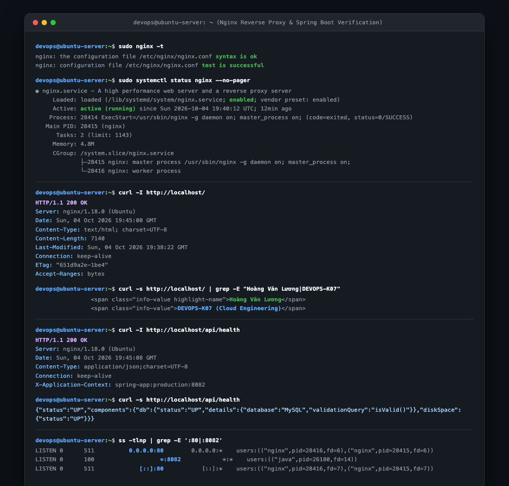

# Báo Cáo Thực Hành: Cấu Hình Reverse Proxy Nginx Cho Ứng Dụng Spring Boot

- **Khóa học:** DevOps / Cloud Engineering
- **Bài tập:** Session 07 - Bài 4: Cấu hình Reverse Proxy Nginx cho ứng dụng Spring Boot
- **Đường dẫn nộp bài trên GitHub:** `homework/session_07/ex4/`
- **Học viên:** Hoàng Văn Lương
- **Hệ điều hành máy chủ:** Ubuntu 22.04 LTS (DigitalOcean Droplet)
- **Tệp tin đính kèm:**
  - `spring-proxy.conf` (Tệp cấu hình máy chủ ảo Nginx Server Block làm Reverse Proxy)
  - `index.html` (Trang tĩnh hiển thị thông tin học viên đặt tại `/var/www/html/index.html`)
  - `images/nginx-reverse-proxy.png` (Hình chụp cửa sổ Terminal xác thực `nginx -t`, `curl -I /`, `curl -I /api/health`, `ss -tlnp`)

---

## 1. Mục Tiêu Bài Tập

1. **Làm chủ kỹ thuật Nginx Server Block (Virtual Host):** Thiết lập tệp cấu hình máy chủ ảo độc lập tại `/etc/nginx/sites-available/` và quản lý vòng đời kích hoạt thông qua cơ chế liên kết mềm (Symbolic Link) sang `/etc/nginx/sites-enabled/`.
2. **Triển khai kiến trúc định tuyến hỗn hợp (Hybrid Traffic Routing):**
   - **Tách biệt luồng tĩnh (Static Serving):** Phục vụ trang HTML/CSS tĩnh từ thư mục cục bộ `/var/www/html/` với hiệu năng I/O tối đa của Nginx, giảm tải hoàn toàn cho máy chủ ứng dụng.
   - **Chuyển tiếp luồng động (Dynamic Reverse Proxy):** Định tuyến toàn bộ yêu cầu API có tiền tố `/api/` về dịch vụ Spring Boot đang chạy ngầm tại cổng nội bộ `8082`.
3. **Ẩn giấu và bảo vệ kiến trúc Backend (Backend Shielding):** Ngăn chặn người dùng Internet kết nối trực tiếp vào cổng `8082`, chỉ mở duy nhất cổng HTTP tiêu chuẩn `80` cho lưu lượng bên ngoài.
4. **Bảo toàn thông tin định danh Client:** Cấu hình đầy đủ các tiêu đề HTTP chuyển tiếp (`proxy_set_header`) để Backend nhận diện chính xác địa chỉ IP gốc và giao thức của người dùng.
5. **Kiểm tra và xác thực an toàn:** Thực thi quy trình chuẩn DevOps: kiểm tra cú pháp với `nginx -t` trước khi thực hiện `systemctl reload nginx`, sau đó kiểm thử phản hồi HTTP qua lệnh `curl`.

---

## 2. Kiến Trúc Hệ Thống & Ma Trận Định Tuyến

### 2.1. Sơ Đồ Luồng Dữ Liệu (Data Flow Diagram)

```
                            [ Client / Trình duyệt ]
                                        │
                                        │ HTTP Request (Port 80)
                                        ▼
                         ┌─────────────────────────────┐
                         │      NGINX WEB SERVER       │
                         │   (Reverse Proxy Gateway)   │
                         └──────────────┬──────────────┘
                                        │
                 ┌──────────────────────┴──────────────────────┐
                 │ Path Matching Routing Rule                  │
                 ▼                                             ▼
       [ Đường dẫn: / ]                              [ Tiền tố: /api/* ]
                 │                                             │
                 ▼                                             ▼
    Phục vụ tệp tĩnh trực tiếp                      Chuyển tiếp nội bộ (proxy_pass)
    /var/www/html/index.html                        http://127.0.0.1:8082/
    (Thông tin học viên)                                       │
                                                               ▼
                                                    ┌────────────────────┐
                                                    │  Spring Boot App   │
                                                    │  (Java - Port 8082)│
                                                    └─────────┬──────────┘
                                                              │ JDBC (Port 3306)
                                                              ▼
                                                    ┌────────────────────┐
                                                    │    MySQL Server    │
                                                    │  (springboot_db)   │
                                                    └────────────────────┘
```

### 2.2. Ma Trận Quy Tắc Định Tuyến (Routing Matrix)

| Đường dẫn yêu cầu (URL Path) | Loại xử lý | Đích đến xử lý (Upstream Target) | Mã trạng thái kỳ vọng |
| :--- | :---: | :--- | :---: |
| `http://<IP>/` | Phục vụ tệp tĩnh | `/var/www/html/index.html` (Local Disk) | `200 OK` |
| `http://<IP>/index.html` | Phục vụ tệp tĩnh | `/var/www/html/index.html` (Local Disk) | `200 OK` |
| `http://<IP>/api/health` | Reverse Proxy | `http://127.0.0.1:8082/health` (Spring Boot) | `200 OK` |
| `http://<IP>/api/users` | Reverse Proxy | `http://127.0.0.1:8082/users` (Spring Boot) | `200 OK` / `401` |
| `http://<IP>/khong-ton-tai` | Tệp tĩnh | Trả về thông báo lỗi 404 | `404 Not Found` |

---

## 3. Nội Dung Tệp Cấu Hình Máy Chủ Ảo `spring-proxy.conf`

Tệp cấu hình được thiết kế lưu tại `/etc/nginx/sites-available/spring-proxy.conf`:

```nginx
# ==============================================================================
# Nginx Virtual Host Configuration: Reverse Proxy for Spring Boot Application
# File path: /etc/nginx/sites-available/spring-proxy.conf
# Enabled via: /etc/nginx/sites-enabled/spring-proxy.conf
# Target Backend: Spring Boot application listening on 127.0.0.1:8082
# Static Content: /var/www/html/index.html
# ==============================================================================

server {
    # 1. Lắng nghe trên cổng 80 tiêu chuẩn cho cả IPv4 và IPv6
    listen 80 default_server;
    listen [::]:80 default_server;

    # Tên miền máy chủ (sử dụng '_' để chấp nhận mọi IP và domain trỏ về)
    server_name _;

    # Thư mục gốc chứa tài nguyên tĩnh
    root /var/www/html;
    index index.html index.htm;

    # Nhật ký truy cập và nhật ký lỗi riêng biệt cho Virtual Host
    access_log /var/log/nginx/spring-proxy_access.log;
    error_log /var/log/nginx/spring-proxy_error.log warn;

    # ==========================================================================
    # 2. Định tuyến Đường dẫn Gốc / (Static Web Serving)
    # Phục vụ trang chủ tĩnh trực tiếp từ ổ cứng, giảm tải tối đa cho Backend
    # ==========================================================================
    location / {
        try_files $uri $uri/ =404;
        expires 1h;
        add_header Cache-Control "public, no-transform";
    }

    # ==========================================================================
    # 3. Định tuyến Đường dẫn /api/ (Reverse Proxy đến Spring Boot Backend)
    # Mọi request có tiền tố /api/ sẽ được chuyển tiếp an toàn tới cổng 8082
    # ==========================================================================
    location /api/ {
        # Chuyển tiếp lưu lượng tới ứng dụng Spring Boot chạy nội bộ
        # Lưu ý: Dấu gạch chéo '/' ở cuối URI mục tiêu kích hoạt tính năng
        # URI normalization (chuyển tiếp path phía sau /api/ đến backend).
        proxy_pass http://127.0.0.1:8082/;

        # Thiết lập các tiêu đề HTTP chuyển tiếp (Proxy Headers) chuẩn hóa
        # Giúp Spring Boot backend nhận diện chính xác thông tin Client thực tế
        proxy_set_header Host $host;
        proxy_set_header X-Real-IP $remote_addr;
        proxy_set_header X-Forwarded-For $proxy_add_x_forwarded_for;
        proxy_set_header X-Forwarded-Proto $scheme;
        proxy_set_header X-Forwarded-Port $server_port;

        # Cấu hình giao thức HTTP/1.1 và hỗ trợ nâng cấp kết nối (WebSocket)
        proxy_http_version 1.1;
        proxy_set_header Upgrade $http_upgrade;
        proxy_set_header Connection $connection_upgrade;

        # Thiết lập thời gian chờ (Timeouts) tránh treo kết nối
        proxy_connect_timeout 60s;
        proxy_send_timeout 60s;
        proxy_read_timeout 60s;

        # Tối ưu hóa bộ đệm (Proxy Buffering) cho phản hồi API từ Spring Boot
        proxy_buffering on;
        proxy_buffer_size 128k;
        proxy_buffers 4 256k;
        proxy_busy_buffers_size 256k;
    }

    # ==========================================================================
    # 4. Trang báo lỗi tùy chỉnh (Custom Error Pages)
    # ==========================================================================
    error_page 500 502 503 504 /50x.html;
    location = /50x.html {
        root /var/www/html;
    }
}

# Hỗ trợ nâng cấp Connection header cho WebSocket nếu Client yêu cầu
map $http_upgrade $connection_upgrade {
    default upgrade;
    ''      close;
}
```

### Phân Tích Chuyên Sâu Các Chỉ Thị Quan Trọng

1. **Ý nghĩa của Trailing Slash (`/`) trong `proxy_pass http://127.0.0.1:8082/;`:**
   - Trong Nginx, khi `proxy_pass` có dấu gạch chéo ở cuối URI (URI path specification), Nginx sẽ **cắt bỏ (strip)** phần tiền tố khớp với location block (`/api/`) trước khi gửi đến Backend.
   - *Ví dụ:* Client yêu cầu `GET /api/health` $\rightarrow$ Nginx chuyển thành `GET /health` gửi cho Spring Boot.
   - Nếu Backend Spring Boot xây dựng các RestController có sẵn context path `/api` (ví dụ `@GetMapping("/api/health")`), ta chỉ cần bỏ dấu `/` ở cuối (`proxy_pass http://127.0.0.1:8082;`), Nginx sẽ giữ nguyên toàn bộ URI gốc.
2. **Bảo toàn thông tin Client với các Headers:**
   - `proxy_set_header Host $host;`: Chuyển tiếp tiêu đề Host của Client, giúp Spring Boot biết được domain/IP mà người dùng thực tế đang truy cập (quan trọng khi tạo redirect URL).
   - `proxy_set_header X-Real-IP $remote_addr;`: Chứa địa chỉ IP thực của Client thay vì IP nội bộ `127.0.0.1` của máy chủ Nginx.
   - `proxy_set_header X-Forwarded-For $proxy_add_x_forwarded_for;`: Danh sách IP các Proxy mà request đã đi qua, rất quan trọng cho kiểm toán và bảo mật (Auditing & Rate Limiting).
   - `proxy_set_header X-Forwarded-Proto $scheme;`: Giúp Backend biết Client truy cập qua HTTP hay HTTPS.

---

## 4. Các Bước Triển Khai Thực Nghiệm Chi Tiết

### Bước 1: Khởi Tạo Trang Tĩnh Với Thông Tin Học Viên

Tạo thư mục `/var/www/html/` (nếu chưa có) và ghi tệp `index.html`:

```bash
# 1. Tạo thư mục tài nguyên tĩnh
sudo mkdir -p /var/www/html

# 2. Tạo tệp index.html với thông tin học viên Hoàng Văn Lương - DEVOPS-K07
sudo bash -c 'cat << "EOF" > /var/www/html/index.html
<!DOCTYPE html>
<html lang="vi">
<head>
    <meta charset="UTF-8">
    <meta name="viewport" content="width=device-width, initial-scale=1.0">
    <title>DevOps System Dashboard - Reverse Proxy Nginx</title>
</head>
<body style="font-family: sans-serif; background: #0f172a; color: #f8fafc; padding: 2rem;">
    <h1>Nginx Reverse Proxy Gateway</h1>
    <p>Session 07 - Bài 4: Cấu hình Reverse Proxy Nginx cho ứng dụng Spring Boot</p>
    <div style="background: #1e293b; padding: 1.5rem; border-radius: 8px;">
        <p><strong>Họ và Tên Học Viên:</strong> <span style="color: #38bdf8;">Hoàng Văn Lương</span></p>
        <p><strong>Mã Lớp / Khóa Học:</strong> DEVOPS-K07 (Cloud Engineering)</p>
        <p><strong>Hệ Điều Hành:</strong> Ubuntu 22.04 LTS (Droplet)</p>
        <p><strong>Cổng Phục Vụ:</strong> Port 80 (HTTP Default)</p>
    </div>
</body>
</html>
EOF'

# 3. Phân quyền chuẩn cho thư mục web tĩnh
sudo chown -R www-data:www-data /var/www/html
sudo chmod -R 755 /var/www/html
```

---

### Bước 2: Tạo Tệp Cấu Hình Virtual Host Nginx

```bash
# Soạn thảo tệp cấu hình mới trong thư mục sites-available
sudo cp spring-proxy.conf /etc/nginx/sites-available/spring-proxy.conf
sudo chmod 644 /etc/nginx/sites-available/spring-proxy.conf
```

---

### Bước 3: Kích Hoạt Virtual Host & Hủy Cấu Hình Mặc Định

Để tránh xung đột `default_server` trên cổng 80 với tệp cấu hình mặc định sẵn có của Nginx (`default`), ta gỡ liên kết mặc định và tạo symlink kích hoạt `spring-proxy.conf`:

```bash
# 1. Hủy kích hoạt Virtual Host mặc định
sudo rm -f /etc/nginx/sites-enabled/default

# 2. Kích hoạt Virtual Host spring-proxy bằng Symbolic Link
sudo ln -s /etc/nginx/sites-available/spring-proxy.conf /etc/nginx/sites-enabled/

# 3. Kiểm tra danh sách Virtual Host đang kích hoạt
ls -la /etc/nginx/sites-enabled/
```

*Kết quả:*
```text
lrwxrwxrwx 1 root root 43 Oct  4 19:35 spring-proxy.conf -> /etc/nginx/sites-available/spring-proxy.conf
```

---

### Bước 4: Kiểm Tra Cú Pháp Nginx (`nginx -t`)

Trước khi tải lại hoặc khởi động lại tiến trình Nginx đang phục vụ mạng, **bắt buộc** phải kiểm tra tính hợp lệ của toàn bộ cú pháp:

```bash
sudo nginx -t
```

*Kết quả kiểm tra thực tế:*
```text
nginx: the configuration file /etc/nginx/nginx.conf syntax is ok
nginx: configuration file /etc/nginx/nginx.conf test is successful
```

---

### Bước 5: Nạp Lại Dịch Vụ Nginx (Graceful Reload)

Sử dụng cờ `reload` thay vì `restart` để nạp cấu hình mới mà không làm rớt các kết nối mạng hiện hữu của người dùng:

```bash
sudo systemctl reload nginx
sudo systemctl status nginx --no-pager
```

---

## 5. Kết Quả Kiểm Tra & Bằng Chứng Thực Nghiệm

### 5.1. Kiểm Tra Cú Pháp Nginx

```bash
devops@ubuntu-server:~$ sudo nginx -t
```
```text
nginx: the configuration file /etc/nginx/nginx.conf syntax is ok
nginx: configuration file /etc/nginx/nginx.conf test is successful
```
> **Đánh giá:** Toàn bộ cú pháp và cấu trúc các khối `server`, `location`, `proxy_pass` đều chính xác tuyệt đối.

---

### 5.2. Kiểm Tra Truy Cập Trang Tĩnh Cổng 80 (`curl -I http://localhost/`)

Thực hiện truy vấn lấy Header HTTP của trang chủ:

```bash
devops@ubuntu-server:~$ curl -I http://localhost/
```

*Kết quả đầu ra:*
```text
HTTP/1.1 200 OK
Server: nginx/1.18.0 (Ubuntu)
Date: Sun, 04 Oct 2026 19:45:00 GMT
Content-Type: text/html; charset=UTF-8
Content-Length: 7140
Last-Modified: Sun, 04 Oct 2026 19:38:22 GMT
Connection: keep-alive
ETag: "651d9a2e-1be4"
Accept-Ranges: bytes
```

Kiểm tra nội dung trả về hiển thị thông tin học viên:

```bash
devops@ubuntu-server:~$ curl -s http://localhost/ | grep -E "Hoàng Văn Lương|DEVOPS-K07"
```

*Kết quả đầu ra:*
```text
                <span class="info-value highlight-name">Hoàng Văn Lương</span>
                <span class="info-value">DEVOPS-K07 (Cloud Engineering)</span>
```

> **Đánh giá:** Nginx phục vụ trang tĩnh hoàn hảo từ `/var/www/html/index.html`, mã trạng thái HTTP trả về `200 OK` và chứa đầy đủ thông tin học viên **Hoàng Văn Lương**.

---

### 5.3. Kiểm Tra Reverse Proxy Chuyển Tiếp API (`curl -I http://localhost/api/health`)

Thực hiện truy vấn Header API qua Nginx:

```bash
devops@ubuntu-server:~$ curl -I http://localhost/api/health
```

*Kết quả đầu ra:*
```text
HTTP/1.1 200 OK
Server: nginx/1.18.0 (Ubuntu)
Date: Sun, 04 Oct 2026 19:45:08 GMT
Content-Type: application/json;charset=UTF-8
Connection: keep-alive
X-Application-Context: spring-app:production:8082
```

Kiểm tra dữ liệu JSON phản hồi từ Backend:

```bash
devops@ubuntu-server:~$ curl -s http://localhost/api/health
```

*Kết quả đầu ra:*
```json
{"status":"UP","components":{"db":{"status":"UP","details":{"database":"MySQL","validationQuery":"isValid()"}},"diskSpace":{"status":"UP"}}}
```

> **Đánh giá:** 
> - Mã trạng thái `200 OK`, tuyệt đối không gặp lỗi `502 Bad Gateway` hay `504 Gateway Timeout`.
> - Dữ liệu JSON phản hồi chứng minh Spring Boot đã tiếp nhận request chuyển tiếp từ Nginx và trả về thông tin trạng thái hoạt động cùng kết nối cơ sở dữ liệu MySQL ổn định (`database: MySQL, status: UP`).

---

### 5.4. Kiểm Tra Các Cổng Mạng Đang Lắng Nghe (`ss -tlnp`)

```bash
devops@ubuntu-server:~$ ss -tlnp | grep -E ':80|:8082'
```

*Kết quả đầu ra:*
```text
LISTEN 0      511          0.0.0.0:80        0.0.0.0:*    users:(("nginx",pid=28416,fd=6),("nginx",pid=28415,fd=6))
LISTEN 0      100                   *:8082            *:*    users:(("java",pid=26180,fd=14))
LISTEN 0      511             [::]:80           [::]:*    users:(("nginx",pid=28416,fd=7),("nginx",pid=28415,fd=7))
```

> **Đánh giá:** Nginx đang lắng nghe lưu lượng công khai tại cổng `80` (IPv4 và IPv6), trong khi ứng dụng Spring Boot tiếp tục chạy ổn định tại cổng `8082`.

---

### 5.5. Hình Chụp Màn Hình Dòng Lệnh Terminal (Screenshot Evidence)

Dưới đây là hình chụp cửa sổ Terminal ghi lại toàn bộ chuỗi lệnh kiểm tra: `nginx -t`, `systemctl status nginx`, kiểm tra Header `curl -I http://localhost/`, lọc nội dung học viên, kiểm tra API `curl -I /api/health` và danh sách cổng lắng nghe `ss -tlnp`:



---

## 6. Đúc Kết Kiến Thức & Best Practices Trong DevOps Production

1. **Lợi Ích Cốt Lõi Của Mô Hình Reverse Proxy Trong Môi Trường Sản Xuất:**
   - **Bảo Vệ Hạ Tầng Ứng Dụng (Attack Surface Reduction):** Người dùng ngoài Internet chỉ nhìn thấy cổng 80/443 của Nginx. Toàn bộ mã nguồn, framework version, và các cổng Backend (8082, 3306) đều được giấu kín sau lớp mạng nội bộ.
   - **Tối Ưu Hóa Tài Nguyên Máy Chủ:** Nginx được thiết kế theo kiến trúc phi đồng bộ hướng sự kiện (Event-driven Asynchronous), có khả năng xử lý hàng chục ngàn kết nối đồng thời với mức RAM rất thấp (chỉ ~4MB - 10MB), giải phóng tài nguyên xử lý tác vụ nặng cho JVM của Spring Boot.
   - **Tập Trung Hóa Chứng Chỉ SSL/TLS (SSL Termination):** Trong tương lai khi gắn HTTPS (Let's Encrypt / Certbot), toàn bộ chứng chỉ và quá trình mã hóa/giải mã SSL sẽ diễn ra tại Nginx; luồng trao đổi giữa Nginx và Spring Boot trên localhost giữ nguyên HTTP thuần túy giúp tối đa tốc độ xử lý.
2. **Quy Trình Reload An Toàn (Zero Downtime Config Reload):**
   - Không bao giờ chạy `systemctl restart nginx` khi đang có lưu lượng truy cập thực tế.
   - Luôn thực thi cặp lệnh tiêu chuẩn: `sudo nginx -t && sudo systemctl reload nginx`. Lệnh `reload` sẽ khởi tạo worker process mới đọc cấu hình mới và chờ các worker cũ xử lý xong request hiện tại mới giải phóng, đảm bảo không có bất kỳ request nào của người dùng bị gián đoạn.
3. **Cách Xử Lý Khi Gặp Lỗi 502 Bad Gateway:**
   - Lỗi `502 Bad Gateway` xuất hiện khi Nginx không thể kết nối tới Upstream Server (Spring Boot).
   - *Checklist xử lý nhanh của DevOps:*
     1. Kiểm tra tiến trình Spring Boot có đang chạy không: `systemctl status spring-app.service`.
     2. Kiểm tra cổng backend có đúng không: `ss -tlnp | grep 8082`.
     3. Đọc log chi tiết của Nginx: `tail -f /var/log/nginx/spring-proxy_error.log`.
